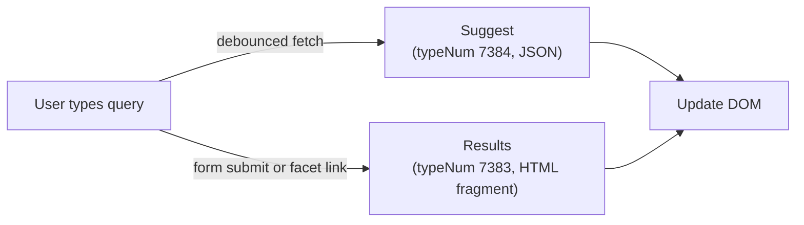

# EXT:solr Frontend: Shipped Controllers and Custom JavaScript

> Sub-guide of `typo3-solr`, loaded from its `SKILL.md` when needed: how the vanilla JavaScript that ships with EXT:solr 14 binds to the search markup, how to keep it working in your own Fluid templates, and how to replace it with your own fetch code where the shipped behaviour is not enough. Verified against EXT:solr 14.0.2 (`composer.lock` of a TYPO3 14.3 project, 2026-10-31).

## Contents

- [1. What EXT:solr 14 ships](#1-what-extsolr-14-ships)
- [2. Keeping the shipped controllers in your own templates](#2-keeping-the-shipped-controllers-in-your-own-templates)
- [3. Endpoints and parameters](#3-endpoints-and-parameters)
- [4. Own suggest implementation](#4-own-suggest-implementation)
- [5. Own facet and result loading](#5-own-facet-and-result-loading)
- [6. Old patterns (EXT:solr 13 and older)](#6-old-patterns-extsolr-13-and-older)

## 1. What EXT:solr 14 ships

EXT:solr 14 has no jQuery dependency. `Resources/Public/JavaScript/` holds plain ES classes, each
included by the static template or example that needs it:

| File | Included by | Binds to | Does |
|---|---|---|---|
| `search_controller.js` | "Search - Ajaxify the search results" | every `a.solr-ajaxified` | fetches the link with `type=7383`, replaces the closest `.tx_solr` container, shows a `.tx-solr-loader` spinner, rewrites the URL with `history.replaceState`, then dispatches `tx_solr_updated` on `document.body` and re-binds itself on that event |
| `suggest_controller.js` + `autocomplete.min.js` | "Search - (Example) Suggest/autocomplete" | every `form[data-suggest]` | reads the suggest URL from `data-suggest` and the top-results heading from `data-suggest-header`, requests `tx_solr[queryString]=<typed text>`, renders into an `.tx-solr-autosuggest` list under the `.tx-solr-suggest` input |
| `facet_options_controller.js` | the Options facet examples | `a.tx-solr-facet-show-all`, `.facet-filter-box`, `.tx-solr-facet-hidden`, `.facet-filter-item` | show-all toggle (labels from `data-label-more` / `data-label-less`) and the type-to-filter box |
| `facet_daterange_controller.js` | the DateRange example | elements with `data-facet-name`, `data-facet-url`, `data-range-gap`, `data-facet-reset-url` | date pickers that build the facet URL |
| `facet_numericrange_controller.js` | the NumericRange example | `.tx-solr-numericRange__*` elements with `data-facet-url` | the two-thumb slider |

The shipped Fluid partials already carry these hooks: pagination, sorting, facet options and
"remove facet" links have `class="solr-ajaxified"`, and the `s:searchForm` ViewHelper renders the
`<form>` with `data-suggest` (URL of page type 7384, argument `suggestPageType`) and
`data-suggest-header`. The search input is named `{pluginNamespace}[q]`, so `tx_solr[q]` for the
`pi_results` plugin.

The TypeNum can be changed without editing the script: define a global `solrSearchAjaxType`
before `search_controller.js` runs and it uses that value instead of 7383.

## 2. Keeping the shipped controllers in your own templates

Most projects only need their own markup, not their own JavaScript. Copy the templates through
`plugin.tx_solr.view.templateRootPaths` (and partial/layout paths) and keep the hooks:

- `class="solr-ajaxified"` on every link that should replace the result list without a page load
  (pagination, sorting, facet add/remove). Links without the class reload the page; that is fine
  for links that leave the results page.
- A wrapping element with `class="tx_solr"` around the part the controller may replace. The
  shipped `Results.html` wraps the whole plugin output; the fetched fragment replaces that element,
  so your own JavaScript inside it is lost. Put your scripts outside and re-run them on
  `tx_solr_updated`:

```javascript
const enhanceResults = () => {
  document.querySelectorAll('.tx_solr [data-copy-link]').forEach(bind);
};
enhanceResults();
document.body.addEventListener('tx_solr_updated', enhanceResults);
```

- `<s:searchForm>` for the form, so `data-suggest` and the hidden parameters stay correct. If you
  write the `<form>` yourself, set `data-suggest` to the suggest URL (see section 3) and keep the
  input inside the form with class `tx-solr-suggest`.
- Facet partials keep the classes from the table above when you keep the matching controller.

Include the two static templates "Search - Ajaxify the search results" and
"Search - (Example) Suggest/autocomplete" instead of copying their TypoScript. The shipped
Ajaxify example in 14.0.2 still contains `vendorName` and a `switchableControllerActions` block;
both are ignored on v14 (`switchableControllerActions` deprecated in 10.3, #89463), so drop them
if you do copy the file. What matters is `typeNum = 7383`, `extensionName = Solr`,
`pluginName = pi_results`, `controller = Search`, `action = results`.

## 3. Endpoints and parameters



| Endpoint | TypeNum | Parameter | Returns |
|---|---|---|---|
| Results fragment | 7383 (`Examples/Ajaxify/setup.typoscript`) | the normal results URL: `tx_solr[q]`, facet and sorting parameters | the rendered results plugin without page layout, `Content-type: text/plain` |
| Suggest | 7384 (`Examples/Suggest/setup.typoscript`, plugin `pi_suggest`, controller `Suggest`, action `suggest`) | `tx_solr[queryString]` | JSON |

The suggest JSON has two parts; `documents` is empty unless top results are enabled:

```json
{
  "suggestions": {
    "typo3": 42,
    "typo3 solr": 15
  },
  "documents": {
    "doc_1": {
      "title": "Getting Started with Solr",
      "url": "/getting-started",
      "type": "pages",
      "content": "Learn how to set up..."
    }
  }
}
```

Suggest is enabled by `plugin.tx_solr.suggest = 1` with `suggest.numberOfSuggestions` and
`suggest.suggestField` (the example uses `spell`); the Suggest example static template sets
these and includes the two scripts and `Resources/Public/StyleSheets/Frontend/suggest.css`.

## 4. Own suggest implementation

Write your own suggest only when the shipped autocomplete cannot be styled or structured the way
the design needs (for example a combobox inside a header overlay). Keep the request the same:
`tx_solr[queryString]` against the page type 7384 URL. A minimal accessible combobox:

```javascript
class SolrSuggest {
  constructor(input) {
    this.input = input;
    this.suggestUrl = input.form.dataset.suggest;   // rendered by s:searchForm
    this.list = document.getElementById(input.getAttribute('aria-controls'));
    this.timer = null;
    this.active = -1;
    this.terms = [];

    input.addEventListener('input', () => {
      clearTimeout(this.timer);
      const query = input.value.trim();
      if (query.length < 3) return this.close();
      this.timer = setTimeout(() => this.fetch(query), 250);
    });
    input.addEventListener('keydown', (event) => this.onKeydown(event));
    document.addEventListener('click', (event) => {
      if (!input.contains(event.target) && !this.list.contains(event.target)) this.close();
    });
  }

  async fetch(query) {
    const url = new URL(this.suggestUrl, window.location.origin);
    url.searchParams.set('tx_solr[queryString]', query);
    const response = await fetch(url, { headers: { Accept: 'application/json' } });
    if (!response.ok) return;
    this.render(await response.json());
  }

  render(data) {
    this.list.innerHTML = '';
    this.terms = Object.keys(data.suggestions || {});
    this.active = -1;
    this.terms.forEach((term, index) => {
      const item = document.createElement('li');
      item.role = 'option';
      item.id = `${this.list.id}-${index}`;
      item.textContent = term;
      item.addEventListener('click', () => this.select(term));
      this.list.append(item);
    });
    Object.values(data.documents || {}).forEach((doc) => {
      const item = document.createElement('li');
      item.role = 'option';
      item.innerHTML = `<a href="${doc.url}"></a>`;
      item.firstChild.textContent = doc.title;
      this.list.append(item);
    });
    this.list.hidden = this.terms.length === 0;
    this.input.setAttribute('aria-expanded', String(!this.list.hidden));
  }

  onKeydown(event) {
    if (this.list.hidden) return;
    if (event.key === 'ArrowDown') { event.preventDefault(); this.highlight(Math.min(this.active + 1, this.terms.length - 1)); }
    if (event.key === 'ArrowUp') { event.preventDefault(); this.highlight(Math.max(this.active - 1, -1)); }
    if (event.key === 'Enter' && this.active >= 0) { event.preventDefault(); this.select(this.terms[this.active]); }
    if (event.key === 'Escape') this.close();
  }

  highlight(index) {
    this.active = index;
    this.list.querySelectorAll('[role="option"]').forEach((el, i) => el.classList.toggle('active', i === index));
    if (index >= 0) this.input.setAttribute('aria-activedescendant', `${this.list.id}-${index}`);
    else this.input.removeAttribute('aria-activedescendant');
  }

  select(term) {
    this.input.value = term;
    this.close();
    this.input.form.requestSubmit();
  }

  close() {
    this.list.hidden = true;
    this.list.innerHTML = '';
    this.highlight(-1);
    this.input.setAttribute('aria-expanded', 'false');
  }
}

document.querySelectorAll('input[data-solr-suggest]').forEach((input) => new SolrSuggest(input));
```

Markup inside `<s:searchForm>` (the ViewHelper supplies `data-suggest` on the form). Do not add
`class="tx-solr-suggest"` to this input, or the shipped controller binds to it as well:

```html
<input type="search" name="tx_solr[q]" value="{q}"
       data-solr-suggest role="combobox" aria-autocomplete="list"
       aria-controls="solr-suggest-list" aria-expanded="false" autocomplete="off">
<ul id="solr-suggest-list" role="listbox" class="solr-suggest-dropdown" hidden></ul>
```

## 5. Own facet and result loading

Replace `search_controller.js` only when the replacement rule (closest `.tx_solr`) or the
spinner does not fit. The request stays the same: the link's own URL with `type=7383`. Keep
`history.pushState` so the back button works, dispatch `tx_solr_updated` so other scripts (and the
shipped facet controllers, if you keep them) re-bind:

```javascript
class SolrResults {
  constructor(root) {
    this.root = root;                                   // the element to replace
    document.addEventListener('click', (event) => {
      const link = event.target.closest('a[data-solr-ajax]');
      if (!link || !this.root.contains(link)) return;
      event.preventDefault();
      history.pushState(null, '', link.href);
      this.load(link.href);
    });
    root.closest('form[data-solr-search]')?.addEventListener('submit', (event) => {
      event.preventDefault();
      const url = `${event.target.action}?${new URLSearchParams(new FormData(event.target))}`;
      history.pushState(null, '', url);
      this.load(url);
    });
    window.addEventListener('popstate', () => this.load(window.location.href));
  }

  async load(href) {
    const url = new URL(href, window.location.origin);
    url.searchParams.set('type', '7383');
    this.root.setAttribute('aria-busy', 'true');
    try {
      const response = await fetch(url);
      if (!response.ok) throw new Error(`HTTP ${response.status}`);
      const fragment = document.createRange().createContextualFragment(await response.text());
      const next = fragment.querySelector('[data-solr-results]') ?? fragment;
      this.root.replaceChildren(...next.childNodes);
      document.body.dispatchEvent(new CustomEvent('tx_solr_updated', { bubbles: true }));
    } catch (error) {
      this.root.innerHTML = '<p class="solr-error">Search is currently not available.</p>';
      console.error('Solr results error:', error);
    } finally {
      this.root.setAttribute('aria-busy', 'false');
    }
  }
}

const results = document.querySelector('[data-solr-results]');
if (results) new SolrResults(results);
```

In your partials, mark the links the class should intercept and the element it replaces:

```html
<div data-solr-results>
  <a href="{s:uri.facet.addFacetItem(facet: facet, facetItem: option)}" data-solr-ajax>{option.label}</a>
  <span class="facet-result-count">{option.documentCount}</span>
</div>
```

Facet URLs come from the `s:uri.facet.*` and `s:uri.paginate.*` ViewHelpers, as in the shipped
partials; do not assemble `tx_solr[filter][]` strings by hand.

## 6. Old patterns (EXT:solr 13 and older)

EXT:solr 13 and older shipped jQuery-based `Resources/Public/JavaScript/` files and a results
container that the shipped script found by `div.tx_solr`. To use your own JavaScript there:

1. Do not include the static templates "Search - Ajaxify the search results" and
   "Search - (Example) Suggest/autocomplete".
2. Configure the two page types yourself (TypeNums 7383 and 7384, section 3).
3. Replace the `solr-ajaxified` class with your own `data-solr-*` attributes in the copied
   templates, so the old script cannot bind.
4. Use the classes from sections 4 and 5.

On EXT:solr 14 there is no jQuery to remove; the shipped controllers are the default and the
sections above describe the two places where replacing them is justified.
