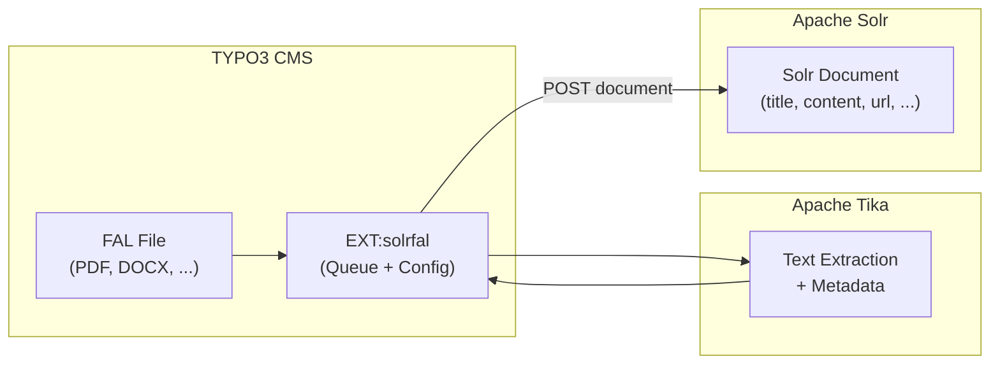

# EXT:solrfal -- File Indexing for Solr

> Sub-guide of `typo3-solr`, loaded from its `SKILL.md` when needed: File indexing with EXT:solrfal and Apache Tika for TYPO3. Index PDFs, DOCX, XLSX and other file formats into Solr for full-text file search. Setup, configuration, Tika Server, troubleshooting.

> **Funding Extension:** EXT:solrfal is a funding contribution extension, not open source. It is available to [EB partners](https://www.typo3-solr.com/solr-for-typo3/open-source-version/) and via the [dkd shop](https://shop.dkd.de/).

> **Verified source:** table, task, field and TypoScript names below come from the solrfal 12.0.5
> package (dkd, 2026, for EXT:solr 12) and its bundled documentation, checked 2026-10-31. A
> solrfal 14 package was not available for this check. Before relying on a name in a project that
> runs solrfal 14, open that project's `vendor/apache-solr-for-typo3/solrfal/` and confirm it; the
> release notes in its `Documentation/Releases/` list renamed keys.

## Contents

- [1. What is solrfal?](#1-what-is-solrfal)
- [2. Prerequisites](#2-prerequisites)
- [3. Installation](#3-installation)
- [4. Tika Server Setup](#4-tika-server-setup)
- [5. Configuration](#5-configuration)
- [6. File Index Queue](#6-file-index-queue)
- [7. Troubleshooting](#7-troubleshooting)
- [8. Testing](#8-testing)

## 1. What is solrfal?

EXT:solrfal enables indexing of TYPO3 FAL (File Abstraction Layer) files into Apache Solr. It extracts text content from binary files (PDFs, Word documents, spreadsheets, etc.) using Apache Tika, and adds them as searchable documents in Solr.



When files are indexed, search results display differently from page results:
- File title and metadata (MIME type, size, author)
- Link to download the file
- References to pages where the file is used

## 2. Prerequisites

| Component | Version | Required? |
|-----------|---------|-----------|
| EXT:solr | Match your TYPO3 Core (see [Version Matrix](https://docs.typo3.org/p/apache-solr-for-typo3/solr/main/en-us/Appendix/VersionMatrix.html)) | Yes |
| EXT:solrfal | 14.0 for EXT:solr 14.0 per the Version Matrix (EB partner package, not on Packagist) | Yes |
| EXT:tika | 14.0.0 (Packagist 2026-08-21, requires `typo3/cms-core ^v14.3.0`; verified 2026-10-31) | Yes |
| Apache Tika Server | 3.2.3 or newer (EXT:tika documents 3.2+; newest 3.x image 3.3.3.0, a 4.x line exists, verified 2026-10-31) | Yes |
| EB Partner access | -- | Yes (funding extension) |

## 3. Installation

```bash
composer require apache-solr-for-typo3/solrfal
composer require apache-solr-for-typo3/tika
```

> EXT:solrfal is not on Packagist. It is distributed via the dkd Composer repository. Add the repository URL provided with your EB partner credentials to `composer.json`.

## 4. Tika Server Setup

The recommended approach is running Tika Server as a Docker container. `3.2.3` is the floor this
skill uses (EXT:tika requires 3.2 or newer); Docker Hub's newest 3.x tag is `3.3.3.0` and a 4.x
line exists (verified 2026-10-31), so pick the newest tag your advisories allow:

```yaml
services:
  tika:
    image: apache/tika:3.2.3
    ports:
      - "9998:9998"
    restart: unless-stopped
```

For DDEV, create `.ddev/docker-compose.tika.yaml`:

```yaml
services:
  tika:
    container_name: ddev-${DDEV_SITENAME}-tika
    image: apache/tika:3.2.3
    restart: "no"
    labels:
      com.ddev.site-name: ${DDEV_SITENAME}
      com.ddev.approot: $DDEV_APPROOT
    expose:
      - "9998"
    environment:
      - VIRTUAL_HOST=$DDEV_HOSTNAME
```

### Configure EXT:tika

1. Open TYPO3 Backend -> Admin Tools -> Settings -> Extension Configuration -> tika
2. Select **"Tika Server"** as the extractor in the General tab
3. Enter connection info in the Server tab:
   - Host: `tika` (Docker service name) or `localhost`
   - Port: `9998`
4. Click **"Check if it works"** to verify the connection

<!-- SCREENSHOT: tika-extension-settings.png - EXT:tika settings in TYPO3 -->

### Alternative: Solr Cell

If you don't want a separate Tika container, use Solr Cell (Tika built into Solr):

1. In EXT:tika settings, select **"Solr Server"** as the extractor
2. Configure the Solr connection (same as EXT:solr)

Limitation: Solr Cell uses the Tika version bundled with Solr, which may be older than the standalone Tika Server.

## 5. Configuration

solrfal hooks into EXT:solr's TypoScript under `plugin.tx_solr.index` and knows three contexts
in which a file can be found (names from the solrfal 12.0.5 TypoScript reference):

```typoscript
plugin.tx_solr.index {
    enableFileIndexing {
        # Page context: files referenced by content elements, found while the page is indexed.
        # Default 1. contentElementTypes maps a CType to the columns that hold file references;
        # the shipped default covers text/textpic (bodytext, header_link) and uploads (media).
        pageContext = 1
        pageContext {
            contentElementTypes {
                textmedia = assets
                my_download_box = downloads
            }
            fileExtensions = pdf, docx, xlsx, pptx
            # take endtime and access groups from the page, access groups from the element
            enableFields = endtime, accessGroups
            contentEnableFields = accessGroups
        }

        # Storage context: every file of a FAL storage, independent of references. Default 0.
        storageContext = 0
        storageContext {
            1 {
                fileExtensions = pdf
            }
        }
    }

    # Record context: files attached to an Index Queue record such as a news item.
    # The table must be in the queue already; `attachments = 1` turns detection on.
    queue {
        news {
            attachments = 1
            # news v14: the FAL relation column is `fal_related_files`; default `*` scans every column
            attachments.fields = fal_related_files
        }
    }

    # Field mapping for file documents, merged per context like a record's `fields` block
    queue._FILES {
        default {
            fileLanguage_stringS = TEXT
            fileLanguage_stringS.data = TSFE:sys_language_uid
        }
        pageContext {
            # overrides for files found on pages
        }
        storageContext.1 {
            # overrides for files of storage 1
        }
        recordContext.news {
            # overrides for files attached to news
        }
    }
}
```

Mapping blocks follow the same syntax as `plugin.tx_solr.index.queue.[configuration].fields`;
`_FILES.default` applies to every file, the context blocks inherit from it. The exact keys and
defaults are in the package's `Documentation/TypoScriptReference/Index.rst`; read that file in the
installed version before adding a key.

### Supported File Types

Tika can extract text from over 1,000 file formats. The most common:

| Format | MIME Type | Extracted Content |
|--------|----------|-------------------|
| PDF | `application/pdf` | Text, metadata, embedded images (text only) |
| DOCX | `application/vnd.openxmlformats-officedocument.wordprocessingml.document` | Text, metadata |
| XLSX | `application/vnd.openxmlformats-officedocument.spreadsheetml.sheet` | Cell content, metadata |
| PPTX | `application/vnd.openxmlformats-officedocument.presentationml.presentation` | Slide text, notes |
| ODT | `application/vnd.oasis.opendocument.text` | Text, metadata |
| RTF | `application/rtf` | Text |
| TXT | `text/plain` | Raw text |
| HTML | `text/html` | Stripped text |
| MSG | `application/vnd.ms-outlook` | Email body, metadata |

### File Size Limits

Large files can cause timeouts or memory issues. Configure limits in EXT:tika extension settings:
- **Maximum file size:** Set a reasonable limit (e.g., 20 MB) to prevent Tika timeouts
- **Tika timeout:** Increase the server timeout for large documents

## 6. File Index Queue

solrfal keeps its own queue table, `tx_solr_indexqueue_file`, next to EXT:solr's
`tx_solr_indexqueue_item`. One row per file and context: the `file` uid, `context_type`
(page, storage or record), `context_site`, `context_language`, `context_access_restrictions`,
the referencing record (`context_record_table`, `context_record_uid`, `context_record_field`,
`context_record_indexing_configuration`), `last_update`, `last_indexed`, `error` and
`error_message`.

Files enter this queue when:
- a page with referencing content elements is indexed (page context),
- the storage context is enabled for their storage,
- a queued record of a table with `attachments = 1` is indexed (record context), and
- their extension passes `fileExtensions`.

Files are **not** processed by EXT:solr's "Index Queue Worker". solrfal registers its own
Scheduler task, **"File Index Queue Worker"** (`ApacheSolrForTypo3\Solrfal\Scheduler\IndexingTask`,
registered through `SC_OPTIONS['scheduler']['tasks']` in 12.0.5), which takes the number of files
per run as an additional field. Add it beside the record worker; `typo3-scheduler-jobs` plans
the interval. Rows with `error = 1` stay in the queue until the error is cleared; solrfal ships
`ResetQueueErrorsCommand` for that (run `vendor/bin/typo3 list` to see its registered name).

### How File Documents Look in Solr

`DocumentFactory` (12.0.5) writes these fields; `type` is the constant `tx_solr_file`:

- `type`: `tx_solr_file`
- `id`, `uid` (queue item uid), `pid`, `site`, `siteHash`, `access`, `appKey` = `EXT:solrfal`
- `title`: the file name unless the mapping overrides it
- `content`: text extracted by Tika
- `url` and `filePublicUrl`: the public URL of the file
- `fileUid`, `fileStorage`, `fileName`, `fileExtension`, `fileMimeType`, `fileSize`, `fileSha1`
- `created`, `changed`: FAL creation and modification time
- plus anything mapped under `queue._FILES`

## 7. Troubleshooting

### Tika Connection Issues

| Symptom | Fix |
|---------|-----|
| "Connection refused" to Tika | Check Docker container is running: `docker ps \| grep tika` |
| Timeout on large files | Increase Tika Server timeout, reduce max file size |
| "Unsupported Media Type" | File format not supported by Tika, check MIME type |
| Empty content extracted | File may be scanned image (needs OCR), or password-protected |

### DDEV-Specific

In DDEV, the Tika service name is `tika` (use this as hostname). Test connectivity:

```bash
ddev exec curl -s http://tika:9998/tika
```

### Files Not Appearing in Search Results

1. Check the context: is `enableFileIndexing.pageContext` on, or `attachments = 1` set for the record's queue configuration with the right `attachments.fields` column?
2. Verify the extension passes `fileExtensions` and Tika supports the type
3. Look at `tx_solr_indexqueue_file`: `SELECT file, context_type, error, error_message FROM tx_solr_indexqueue_file WHERE error = 1`
4. Query Solr Admin: `q=*:*&fq=type:tx_solr_file&fl=id,title,fileName,fileMimeType,url`
5. Ensure the **File Index Queue Worker** task has run, not only the record worker

### Performance

- Index files during off-peak hours (Tika extraction is CPU-intensive)
- Use the two-pass indexing approach: index records first, then process files
- Monitor Tika Server memory usage for large document collections

## 8. Testing

### Verify Tika Extraction

Test Tika directly:

```bash
# Send a PDF to Tika and get extracted text
curl -T /path/to/test.pdf http://tika:9998/tika --header "Accept: text/plain"

# Get metadata
curl -T /path/to/test.pdf http://tika:9998/meta --header "Accept: application/json"
```

### Verify Solr Documents

After indexing, check file documents in Solr Admin:

```
q=*:*&fq=type:tx_solr_file&rows=5&fl=id,title,fileName,fileMimeType,fileSize,url
```

### Functional Test

```php
<?php

declare(strict_types=1);

namespace MyVendor\MyExt\Tests\Functional;

use TYPO3\TestingFramework\Core\Functional\FunctionalTestCase;

final class FileIndexingTest extends FunctionalTestCase
{
    protected array $testExtensionsToLoad = [
        'apache-solr-for-typo3/solr',
        'apache-solr-for-typo3/tika',
        'apache-solr-for-typo3/solrfal',
    ];

    public function testPdfFileIsQueued(): void
    {
        $this->importCSVDataSet(__DIR__ . '/Fixtures/page_with_pdf.csv');

        // solrfal keeps its own queue table
        $queryBuilder = $this->getConnectionPool()
            ->getQueryBuilderForTable('tx_solr_indexqueue_file');
        $count = $queryBuilder
            ->count('uid')
            ->from('tx_solr_indexqueue_file')
            ->where($queryBuilder->expr()->eq('context_type', $queryBuilder->createNamedParameter('page')))
            ->executeQuery()
            ->fetchOne();

        self::assertGreaterThan(0, $count, 'PDF file should be in the file index queue');
    }
}
```
